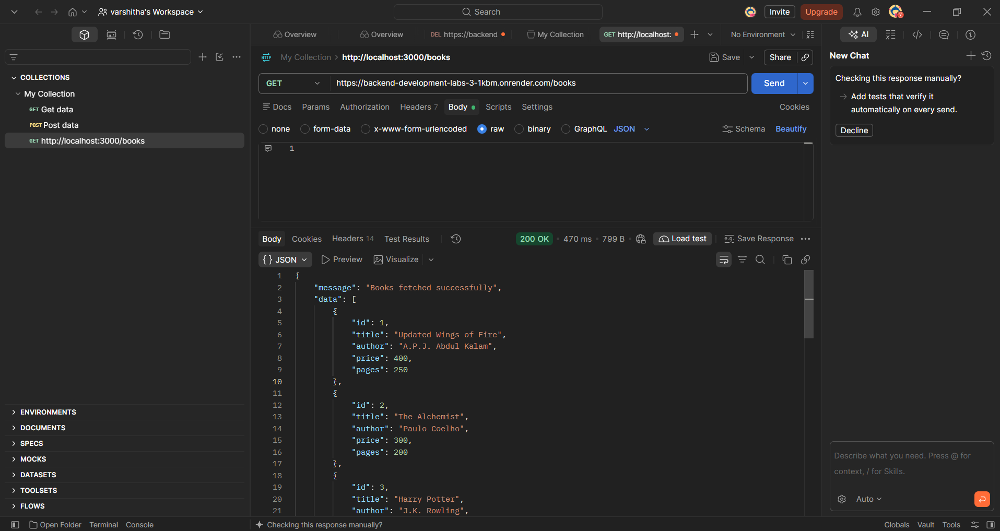
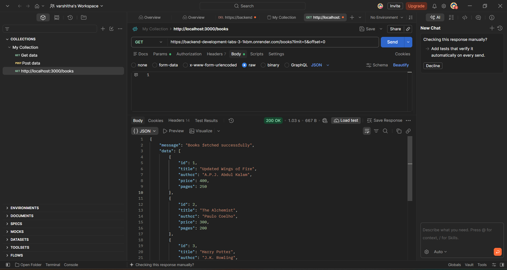
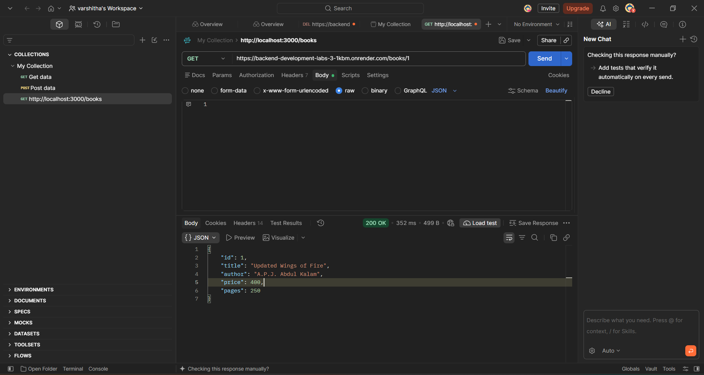
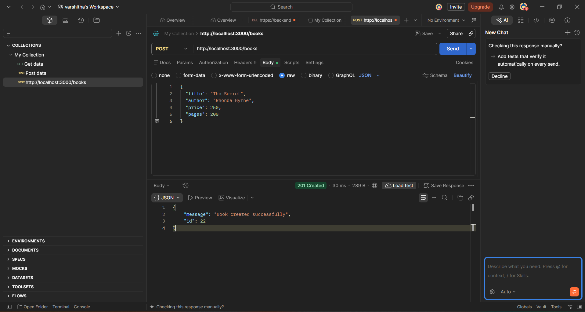
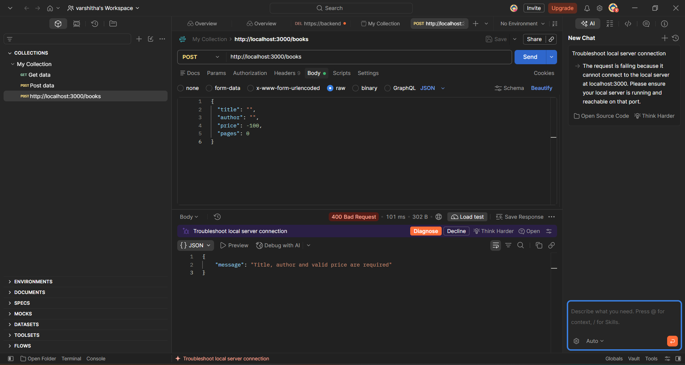
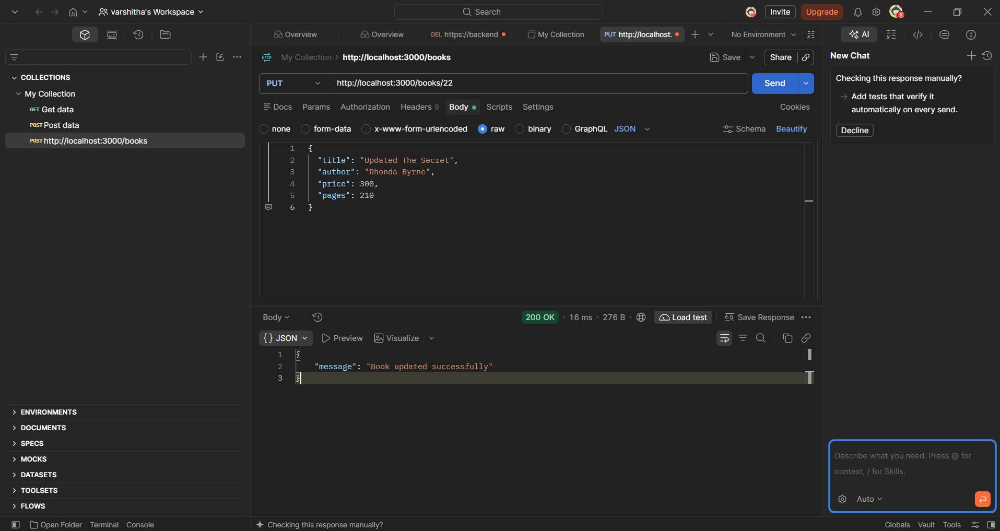
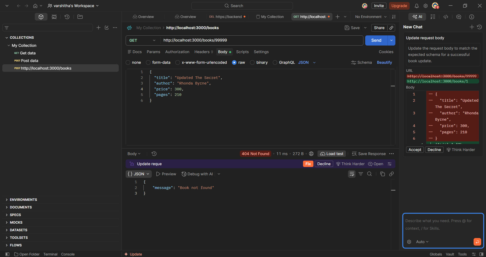

# LAB 3 – REST API, Query Parameters, Validation and Debugging

## 1. Student Details

| Detail | Information |
|---|---|
| Name | Tangella Varshitha |
| Registration Number | 252U1R1238|
| Section | CSE – 2E |
| Course | Backend Development Fundamentals |
| Year and Term | Year II – Term II |
| Institution | Aurora – NIAT |
| Faculty | Yugandhar |

## 2. Project Overview

This project focuses on developing a RESTful Book Management API using Node.js, Express.js and SQLite.

The application provides different API endpoints to manage book records. It allows users to retrieve all books, search books by title, sort records, apply pagination, filter books based on price, retrieve a particular book by ID, add new books, update existing books and delete books.

The project also implements input validation and error handling to ensure that invalid data is not inserted into the database.

Postman is used to test the API endpoints and verify the responses.

## 3. Objectives

- Develop REST API endpoints using Node.js and Express.js.
- Implement GET, POST, PUT and DELETE methods.
- Retrieve all book records from SQLite.
- Search books using query parameters.
- Implement sorting and pagination.
- Filter books using minimum and maximum prices.
- Retrieve individual books using their IDs.
- Add, update and delete book records.
- Validate user input.
- Handle errors using appropriate HTTP status codes.
- Test API functionality using Postman.

## 4. Technologies Used

| Technology | Purpose |
|---|---|
| Node.js | JavaScript runtime environment |
| Express.js | Backend web framework |
| SQLite | Database management |
| JavaScript | Backend programming language |
| Postman | API testing |
| Visual Studio Code | Code editor |
| Git | Version control |
| GitHub | Source code management |
| Render | Backend deployment |

## 5. Project Structure

```text
lab-03/
│
├── screenshots/
│   ├── get-all-books.png
│   ├── search-books.png
│   ├── sort-books.png
│   ├── pagination.png
│   ├── filter-books.png
│   ├── get-book-by-id.png
│   ├── post-book.png
│   ├── validation-error.png
│   ├── put-book.png
│   ├── delete-book.png
│   └── not-found.png
│
├── database.db
├── package.json
├── package-lock.json
├── server.js
└── README.md

Note: `node_modules/` contains installed dependencies and should not be uploaded to GitHub.

## 6. Installation and Setup

### Prerequisites

- Node.js installed.
- npm package manager.
- Visual Studio Code.
- Postman.

### Step 1: Open the Lab 3 folder

```bash
cd "C:\Users\TANGELLA VARSHITHA\OneDrive\Pictures\varshi\Backend\lab-03"
```

### Step 2: Install dependencies

```bash
npm install
```

### Step 3: Start the server

```bash
node server.js
```

### Step 4: Expected terminal output

```text
Database connected successfully
Server running on port 3000
```

### Step 5: Access the API

```text
http://localhost:3000/books
```

## 7. Database Details

The project uses SQLite to store book information.

**Database File:** `database.db`

**Table Name:** `book`

| Column | Data Type | Description |
|---|---|---|
| id | INTEGER | Unique book ID |
| title | TEXT | Name of the book |
| author | TEXT | Name of the author |
| price | REAL | Price of the book |
| pages | INTEGER | Number of pages |

The database stores book records and supports operations such as inserting, retrieving, updating and deleting records.

## 8. REST API Endpoints

The following endpoints are implemented in the project.

| HTTP Method | Endpoint | Description |
|---|---|---|
| GET | `/books` | Retrieve all books |
| GET | `/books/:id` | Retrieve a book using its ID |
| POST | `/books` | Add a new book |
| PUT | `/books/:id` | Update an existing book |
| DELETE | `/books/:id` | Delete a book |

## 9. Query Parameters

The GET `/books` endpoint supports query parameters to retrieve book records in different ways.

| Parameter | Description |
|---|---|
| `search_q` | Search books by partial title |
| `order_by` | Sort records using a selected column |
| `order` | Sorting direction (ASC or DESC) |
| `limit` | Maximum number of records |
| `offset` | Number of records to skip |
| `min_price` | Minimum book price |
| `max_price` | Maximum book price |

### Example Requests

**Search Books**

```text
GET /books?search_q=Atomic
```

**Sort Books**

```text
GET /books?order_by=price&order=DESC
```

**Pagination**

```text
GET /books?limit=5&offset=0
```

**Price Filtering**

```text
GET /books?min_price=200&max_price=400
```

## 10. CRUD Operations

### 10.1 GET – Retrieve All Books

Retrieves all available book records from the SQLite database.

### 10.2 GET – Retrieve Book by ID

Retrieves a particular book using its unique ID.

### 10.3 POST – Add a New Book

Adds a new book record to the database.

Example request:

```json
{
  "title": "The Secret",
  "author": "Rhonda Byrne",
  "price": 250,
  "pages": 200
}
```

Successful response:

```json
{
  "message": "Book created successfully",
  "book": {
    "id": 22,
    "title": "The Secret",
    "author": "Rhonda Byrne",
    "price": 250,
    "pages": 200
  }
}
```

### 10.4 PUT – Update a Book

Updates the details of an existing book using its ID.

Example endpoint:

```text
PUT /books/22
```

Successful response:

```json
{
  "message": "Book updated successfully"
}
```

### 10.5 DELETE – Delete a Book

Deletes an existing book record using its ID.

## 11. Input Validation

Input validation is implemented in the POST endpoint to prevent invalid book details from being inserted.

The API checks:

- Title is provided.
- Author is provided.
- Price is provided.
- Price is a valid number.

Example validation response:

```json
{
  "message": "Title, author and valid price are required"
}
```

The API returns HTTP 400 Bad Request when the submitted details do not satisfy the validation conditions.

## 12. HTTP Status Codes

| Status Code | Meaning | Usage |
|---|---|---|
| 200 | OK | Successful GET, PUT and DELETE |
| 201 | Created | Book successfully added |
| 400 | Bad Request | Invalid input data |
| 404 | Not Found | Book does not exist |
| 500 | Internal Server Error | Unexpected server error |

Example response:

```json
{
  "message": "Book not found"
}
```

## 13. Postman API Testing Screenshots

The following screenshots demonstrate the testing of all major API operations using Postman. All screenshot files are stored in the `screenshots` directory of the Lab 3 project.

### 13.1 GET All Books

Retrieves all available book records from the SQLite database.



### 13.2 Search Books

Tests searching for books using the `search_q` query parameter.


### 13.3 Sort Books

Tests sorting book records by price in descending order.


### 13.4 Pagination

Tests retrieving a limited number of book records using the `limit` and `offset` parameters.



### 13.5 Filter Books

Tests filtering book records using minimum and maximum price values.


### 13.6 GET Book by ID

Tests retrieving an individual book using its unique ID.



### 13.7 POST – Add New Book

Tests adding a new book record using the POST method.



### 13.8 POST – Validation Error

Tests invalid request data and verifies the HTTP 400 Bad Request response.



### 13.9 PUT – Update Book

Tests updating an existing book record using the PUT method.



### 13.10 DELETE – Delete Book

Tests deleting an existing book record using the DELETE method.


### 13.11 GET – Book Not Found

Tests retrieving a non-existing book and verifies the HTTP 404 Not Found response.


## 14. Debugging and Error Handling

During development, different errors were encountered and resolved.

| Error | Explanation | Solution |
|---|---|---|
| ECONNREFUSED | Server was not running | Started the Node.js server |
| Cannot POST | Incorrect HTTP method or endpoint | Checked the Postman method and URL |
| 400 Bad Request | Invalid request body | Provided valid book details |
| 404 Not Found | Requested book ID does not exist | Checked the book ID |
| EADDRINUSE | Port already in use | Stopped the existing server process |

Try-catch blocks are used to handle errors and return JSON responses.

## 15. Deployment

The application is planned to be deployed using Render.

### Deployment Configuration

| Setting | Value |
|---|---|
| Service Type | Web Service |
| Runtime | Node.js |
| Root Directory | `lab-03` |
| Build Command | `npm install` |
| Start Command | `node server.js` |

**Live API URL:**

To be updated after successful deployment.

Note: SQLite data stored on a Render service's local filesystem may not persist after restarts or redeployments. Persistent storage or a managed database is recommended if data must be retained.

## 16. Learning Outcomes

Through this lab, I learned:

- How to create RESTful APIs using Node.js and Express.js.
- How to perform CRUD operations.
- How to work with SQLite databases.
- How to use query parameters.
- How to implement search, sorting and pagination.
- How to filter records based on price.
- How to validate request data.
- How to handle errors and HTTP status codes.
- How to test APIs using Postman.
- How to debug backend applications.

## 17. Conclusion

This lab provided practical experience in developing a Book Management REST API using Node.js, Express.js and SQLite.

By implementing GET, POST, PUT and DELETE operations, I gained an understanding of how backend applications manage data. I also learned how query parameters can be used for searching, sorting, pagination and filtering.

Testing the API using Postman helped me understand request handling, input validation, error responses and HTTP status codes.

Overall, this lab improved my practical knowledge of REST API development, database operations and backend debugging.

## 18. GitHub Repository

Repository: [Add your GitHub repository link here]
