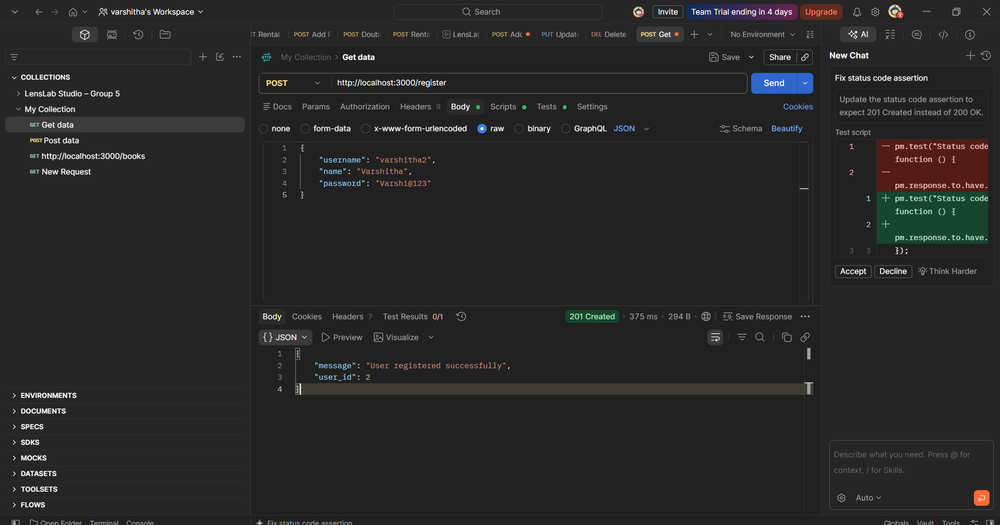
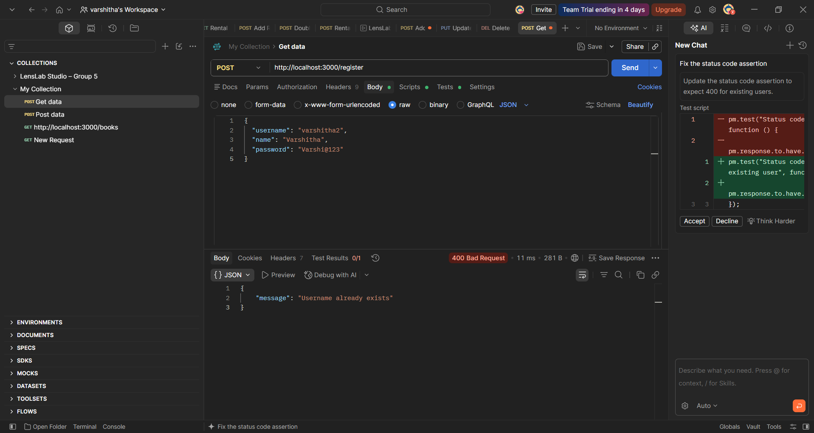
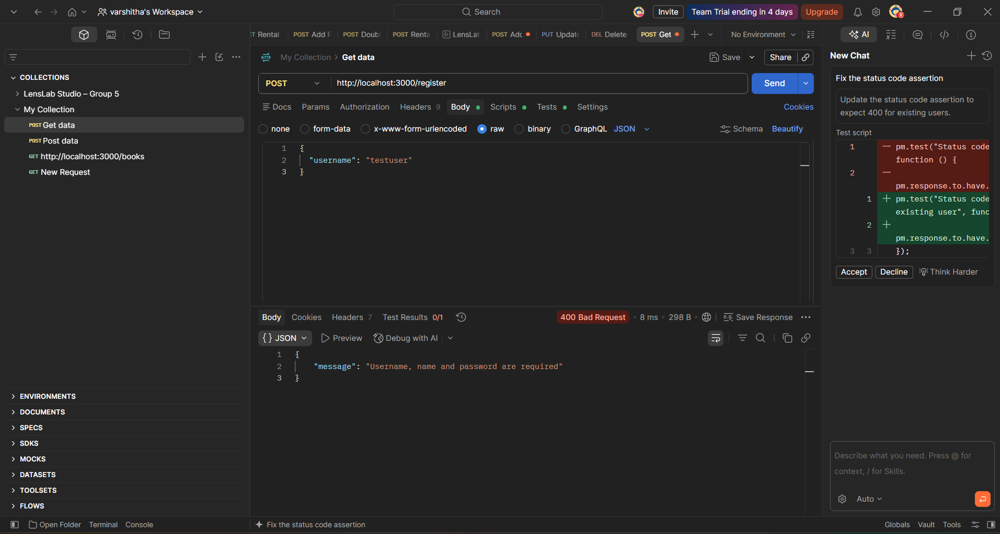
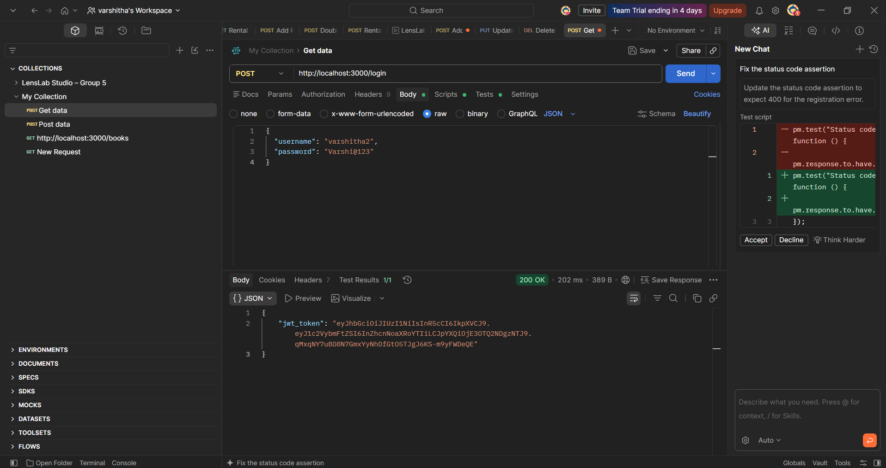
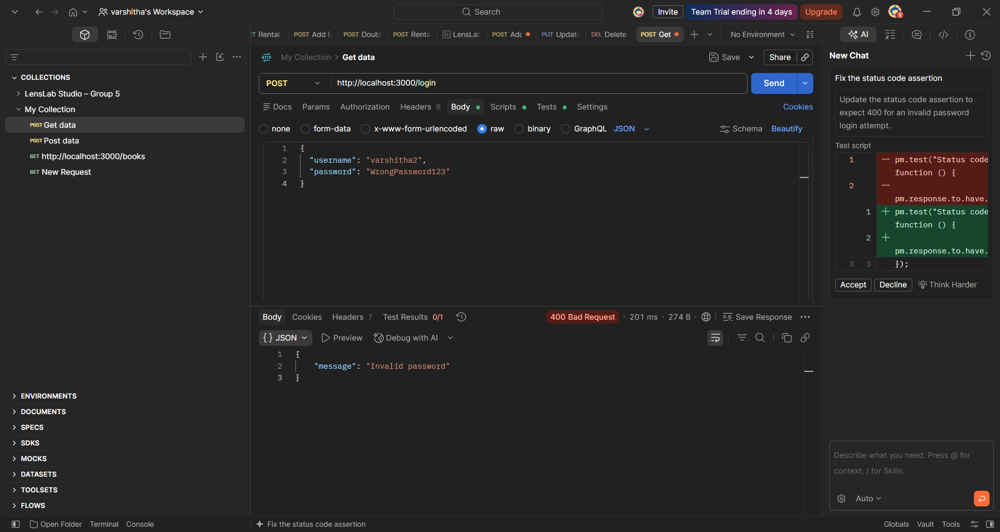
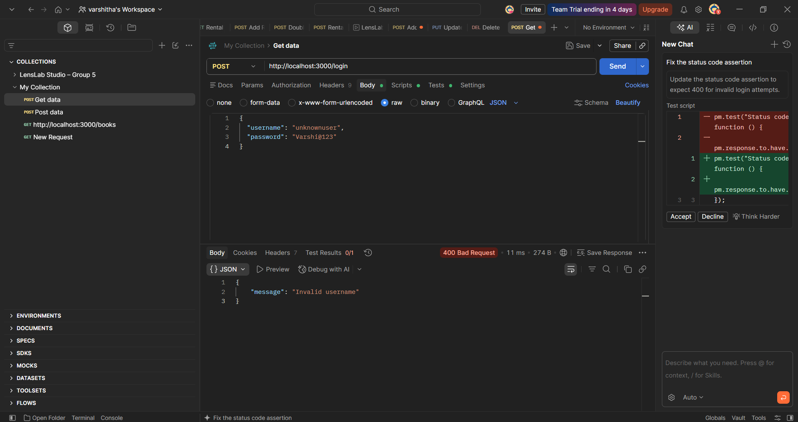
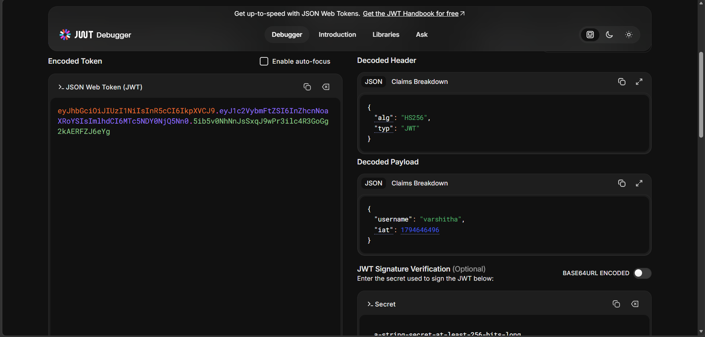
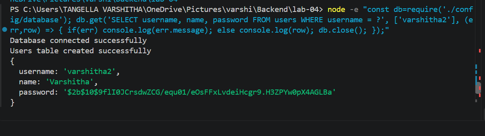

# Lab 4: Registration, Login and JWT

## 1. Student Details

| Detail | Information |
|---|---|
| Name | Tangella Varshitha |
| Registration Number | 252U1R1238 |
| Section | CSE – 2E |
| Course | Backend Development Fundamentals |
| Year | II – Term II |
| Institution | Aurora – NIAT |
| Faculty | Yugandhar |

## 2. Project Overview

This project implements user registration and login using Node.js, Express.js, SQLite, bcrypt and JSON Web Tokens (JWT).

Users can register with a username, name and password. The password is securely hashed using bcrypt before storing it in the database.

Registered users can log in using their username and password. After successful login, the server generates a JWT token.

## 3. Technologies Used

- Node.js
- Express.js
- SQLite
- bcrypt
- jsonwebtoken
- Postman

## 4. Project Setup

### Install dependencies

```bash
npm install
```

### Start the server

```bash
node server.js
```

Server runs at:

```text
http://localhost:3000
```

## 5. API Endpoints

| Method | Endpoint | Description |
|---|---|---|
| GET | `/` | Check server status |
| POST | `/register` | Register a new user |
| POST | `/login` | Log in an existing user |

## 6. API Testing

All endpoints were tested using Postman.

### Registration

- Successful user registration
- Duplicate username validation
- Missing field validation

### Login

- Successful login with correct credentials
- Invalid password validation
- Unknown username validation

### JWT Verification

The generated JWT token was decoded using jwt.io to inspect its header and payload.

### Password Hashing

The SQLite database was checked to verify that passwords are stored as bcrypt hashes instead of plain text.


## 7. Screenshots

### Registration







### Login







### JWT Verification



### Password Hashing




## 8. Deployment

This project was tested and executed locally.

## 9. Security Notes

- Passwords are hashed using bcrypt before storing them.
- JWT payload contains the username, not the password.
- The JWT secret is kept out of this README.
- Database files and environment files should not be uploaded to GitHub.

## 10. Conclusion

This lab helped me understand user registration, login authentication, password hashing, SQLite database operations and JWT token generation using Express.js.